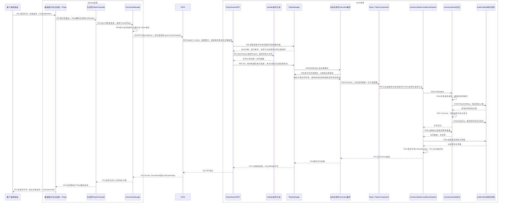
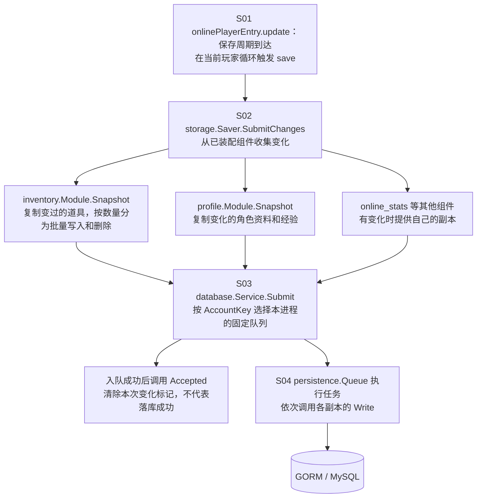

# 一次使用经验道具的完整调用路线

本文以已登录、已选角色、已进入 game 的玩家为前提。客户端发送 UseExpItemReq，成功后收到专用 UseExpItemRep，只含本次道具剩余数量、经验和等级。编号与源码注释对应，可以搜索 R04、R09、S02 等定位。

源码中的 `TODO(业务扩展)` 标出可以添加玩法的位置。

## 请求与响应：R01–R12

R10 是同一个玩家循环内的顺序方法调用，不是组件之间互发 RPC。其他玩家有自己的循环。图画的是成功路径；校验、排队或 RPC 失败会提前返回错误，不会继续执行所有步骤。

客户端按 Rep 中的当前值替换对应字段，remaining_count 为零时移除该道具；不把它当成需要再次加减的差值。成功的 EnterReq → EnterRep.state 汇总完整 PlayerState，包括重复进入同一在线角色。CurrentReq → CurrentRep.state 保留为显式整体同步，不在普通操作后自动调用。错误沿用原生错误通道，不发送伪成功 Rep。

同一连接收到成功的 Enter 回包后，网关把使用经验道具等普通请求发给已绑定的 game。发送前检查 NATS 连接及 Pitaya 本地节点表中的原 game，单次 etcd 健康探测超时不会挡住这些请求。game 收到后由 PlayerManager 核对连接和分配编号，入队并在执行前再次核对。登录、换绑、进入、退出仍走常规 RPC。顶号后，新连接可以用 Enter 获取完整状态。它尚未收到自己的成功 Enter 回包时，网关使用常规 RPC；若 game 已保留在线角色并确认新绑定，普通请求仍可能成功。挑战 Boss 另需查询公共状态归属。

## 定期保存：S01–S04，独立于上面的响应

图中的三个 Snapshot 分支是职责划分，实际代码按组件顺序收集并合成一个队列任务，不并行读取玩家内存。S03 入队后，调用线程清标记与 DB 线程执行任务可以交错，不承诺两者谁先完成。

响应成功表示内存业务处理成功。没有变化的组件返回空快照；入队失败保留变化标记，实际写库失败记录日志，不自动重试。各模块写入可以部分成功。退出复用同一个保存入口，没有新变化也要等该玩家最后一笔已入队的保存完成或超时。

## 按编号找代码

以下路径相对于模板根目录；框架文件从平级仓库进入。

| 编号 | 文件与入口 | 新增普通玩法时 |
| --- | --- | --- |
| R01、R12 | [cmd/client/main.go](../cmd/client/main.go) 的 call | 示例客户端，可增加调用演示 |
| R02 | 平级框架的 `protocol/pitayawire/decoder.go` 中的 Decode，随后由 Pitaya 解码分发 | 通常无需修改 |
| R03 | common/protocol/generated/ 中的 PlayerForwarder；由 [gateway/routes.go](../servers/gateway/routes.go) 登记 | 改协议源后生成，不手改产物 |
| R04、R05、R11 | [connection/player_forward.go](../servers/gateway/internal/connection/player_forward.go) 的 ForwardPlayer、send | 通常无需修改 |
| R06 | [handler/player_session_rpc.go](../servers/game/internal/handler/player_session_rpc.go) 的 Dispatch、receive | 通常无需修改 |
| R07 | [handler/player_request.go](../servers/game/internal/handler/player_request.go) 与 [modules/dispatch.go](../servers/game/internal/player/modules/dispatch.go) | 通常无需修改 |
| R08 | [player/call.go](../servers/game/internal/player/call.go)，复用框架 execution | 通常无需修改 |
| R09 | [player/player.go](../servers/game/internal/player/player.go) 的 RunAction → [inventory/action.go](../servers/game/internal/player/modules/inventory/action.go) | 在自己模块登记请求函数 |
| R10a–R10d | [inventory/use_exp_item.go](../servers/game/internal/player/modules/inventory/use_exp_item.go)、[profile/experience.go](../servers/game/internal/player/modules/profile/experience.go) | 具体玩法和规则 |
| R10e | [inventory/action.go](../servers/game/internal/player/modules/inventory/action.go) 的组件方法构造 UseExpItemRep | 只填写本次相关数据；不调用 components.Current |
| R11 | [common/clusterlink/payload.go](../common/clusterlink/payload.go) 的 EncodeReply、DecodeInto | 通常无需修改 |
| S01 | [player/tick.go](../servers/game/internal/player/tick.go) 的 update 回调 | 通常无需修改调度，周期由配置决定 |
| S02 | [storage/save.go](../servers/game/internal/player/storage/save.go) → 各模块 Snapshot | 在所属模块实现数据副本与保存方法 |
| S03 | [database/task.go](../infrastructure/database/task.go) 的 Submit | 通常无需修改 |
| S04 | 框架 persistence.Queue → 组件 Snapshot 提供的 Write → GORM | 具体保存字段由组件维护 |

装配发生在首次进入角色时，各组件恢复并通过 AfterLoad 检查后，才会在玩家循环中执行请求。新增玩法参照[玩家模块指南](player-modules.md)。主动通知另走[定向推送](player-messages.md)，正常停服和单人下线共享[退出任务](../servers/game/internal/handler/player_exit.go)。
