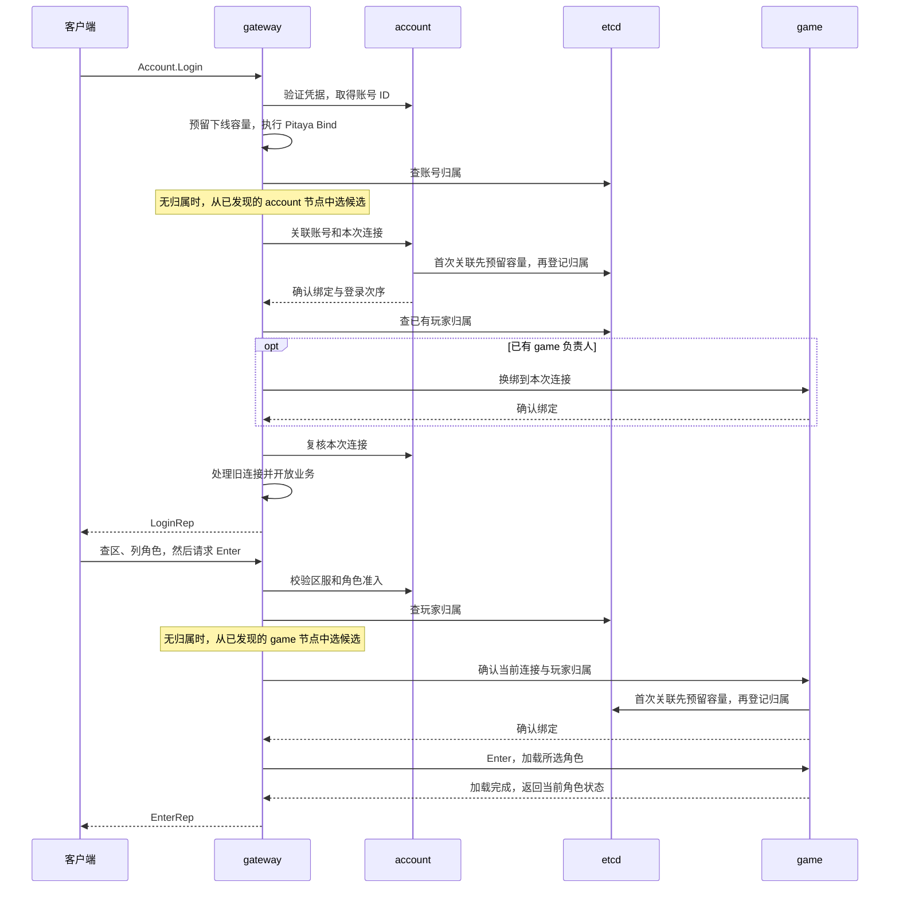

# 登录、目录与玩家节点

客户端只连接 gateway。gateway 通过 Pitaya/NATS RPC 调用 account 和 game。角色所属的逻辑区来自 account 配置，客户端不用选择进程或后端端口。



## 选角与归属

查询角色目录会读 MySQL，返回已保存的角色摘要。显式创建角色由 gateway 先向 account 检查准入，再定向调用 `game.Creation.Create` 的创建事务。仅创建不会建立在线 Player 或登记玩家归属。若 RPC 超时，刷新角色列表确认实际结果，事务可能已经提交。

首次分配时，由调用方选候选节点，接收方有容量才尝试登记。若另一节点已先登记，且候选明确回复自己没有执行绑定，网关最多再定向调用该负责人一次。已有归属继续指向原节点；新增 game 只参与今后的首次分配。节点暂时不可达时不会自动改派。

`Leave` 释放角色，账号在连接关闭前仍在线。显式 `Enter` 时，如果网关记着上一次归属，会重新核对：归属已释放时重新选点，归属已变更时返回 `GAME-RELOGIN-REQUIRED`，查询失败时保留记录。网关在当前连接收到有效 Enter 回包后，普通请求使用原 game 节点和本地绑定，跳过逐次 etcd 健康探测。刚顶号的连接若已换绑、且 game 仍保留在线角色，也可能在显式 Enter 前通过常规 RPC 执行请求；客户端应先发 Enter 取得完整状态。具体调用见[道具请求流程](business-request-flow.md)。

## 同一账号再次登录

同网关的两条连接共用一个账号条目。凭据通过并预留名额后，Pitaya Bind 处理同网关旧连接。account、game 分别确认新绑定后，网关分别转移对它们的下线通知责任。跨网关时，新网关在后端换绑和登录末尾检查后，按旧绑定通知旧网关关闭指定连接。换绑保留后端的在线角色；重连后客户端可请求 `Enter` 获取当前状态。

如果 account 已确认新连接、game 仍用旧连接，新连接此时断开，网关按两处各自记住的身份发送下线通知。若换绑请求已发出而回包未知，也保留待确认目标，由后端核对实际连接。登录接线失败可导致新连接关闭，此时重新登录。

## 本机启动第二个网关

复制 `configs/gateway.json` 为 `configs/gateway-2.local.json`，将 `address` 改为 `127.0.0.1:3251`。保持同一环境的 prefix 和集群连接设置，日志文件或诊断口须独立。在另一个准备好 gateway 凭据的终端执行：

```bat
scripts\Start.bat gateway configs\gateway-2.local.json
```

示例客户端可用 `-url ws://127.0.0.1:3251/` 连接第二个网关。它会在有限次请求后自行退出；观察顶号时须让第一条客户端连接保持在线。
