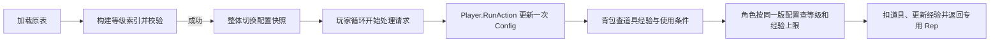

# 数据类型、配置表和热更新

使用一个经验道具会碰到四类对象。它们在代码里各有位置：

| 对象 | 保存什么 | 修改入口 |
| --- | --- | --- |
| 配置表 | 某个道具增加多少经验、需要多少级、每级的经验门槛 | 在独立表格仓维护原表，模板的 `common/gamedata` 加载并提供查询。 |
| 数据库模型 | 某个角色还有几个道具、当前累计经验 | 在 [database.Models](../common/model/database/models.go) 登记 GORM 模型，game 通过 DB 服务加载与保存。 |
| 协议消息 | 这次使用哪个道具、用几个，以及操作完成后的相关数值 | 在独立协议仓定义，再生成到 `common/protocol/generated`。 |
| 在线对象 | 角色当前持有的道具和经验，以及校验、扣除和增加的方法 | 在 `servers/game/internal/player/modules` 下的背包和角色组件中实现。 |

数据库表登记只负责建表。增加玩家存档字段时还需处理加载、组件恢复、变化保存和新角色初始化。[玩家模块](player-modules.md)

## 添加或扩展一张配置表

1. 在平级的 `ht_server_game_tables` 更新数据和 Luban 定义。在模板根目录运行 `scripts/Generate-Tables.bat`，Linux 运行 `sh scripts/Generate-Tables.sh`。产物包括 `common/gamedata/generated` 的 Go 类型和 `tables/exported` 的 JSON、`manifest.json`；生成目录不入库。
2. 在 [gamedata.New](../common/gamedata/load.go) 的 `RequiredFiles` 登记运行时需要的 JSON。它检查清单、文件摘要和兼容版本，再通过 Luban 生成的 `NewTables` 加载原表。模板要求 `tbtext.json`、`tbitem.json`、`tblevel.json`。
3. 只需按 ID 读取时参照 [item.go](../common/gamedata/item.go)，返回业务需要的值。需要派生查询时参照 [level.go](../common/gamedata/level.go)，加载阶段按等级排好索引，运行时通过 `LevelForExp` 查当前经验对应的等级。
4. 在 [ValidateGameplay](../common/gamedata/gameplay.go) 添加跨表约束。当前校验初始道具存在、等级从 1 连续递增、初始经验为 0、后续门槛递增，以及道具的经验和使用等级范围。完整版本通过后才对业务可见。

## 发布新版和读取

在运行 game 的控制台输入 `reload-tables <完整包目录>`。目录要包含配套的清单和整组导出文件；当前兼容标识为 `gameplay-v2` 和 `gameplay-reader-v2`。加载、构建派生索引或校验失败时继续使用旧快照。每个 game 进程单独执行重载。[重载入口](../infrastructure/runtime/console.go)

背包和角色在恢复时保存同一个 `PlayerComponents.Config` 地址。`RefreshConfig` 只替换只读入口，原表和等级索引在进程内共享，无需逐玩家复制整表。同一请求执行期间发生重载也不会混读两个版本。表变更不会自动改写在线经验或补发奖励。[组件配置入口](../servers/game/internal/player/modules/load.go) · [业务请求入口](../servers/game/internal/player/player.go)
