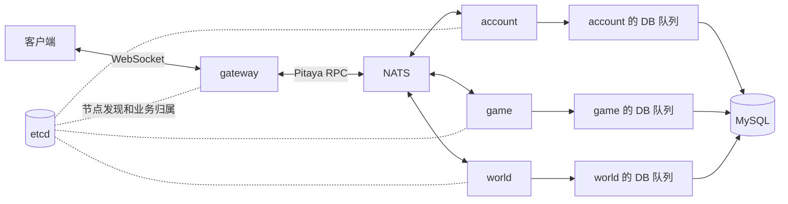

# 从模板增加一个业务功能

先按[入门说明](getting-started.md)生成协议、配置表和玩家组件导入，启动 account、game、gateway。需要挑战 Boss 时再启动 world。[示例客户端](sample-client.md)

## 先找到要改的进程

| 进程 | 启动时装配 | 业务入口 |
| --- | --- | --- |
| [gateway](../servers/gateway/server.go) | 连接管理器、account 与 game 的归属查询 | [网关路由](../servers/gateway/routes.go)登记登录、角色目录、生成的 Player 转发和内部连接 RPC。 |
| [account](../servers/account/server.go) | 发号器、数据库、账号归属、在线账号与逻辑区目录 | 验证凭据、查询或创建账号、绑定账号连接、提供目录。 |
| [game](../servers/game/server.go) | 发号器、数据库、配置表、game 和 Boss 归属、玩家管理器 | [game 路由](../servers/game/routes.go)登记角色创建、会话与玩家请求。具体玩法放在玩家模块。 |
| [world](../servers/world/server.go) | 数据库、公共归属和 Boss 状态 | 内部 `Boss.Claim` 认领范围，`Boss.Attack` 修改血量。 |

NATS 把内部 RPC 发往节点，etcd 提供节点发现和归属记录，业务状态由对应进程持有并写入数据库。配置服务地址和用户凭据见 [NATS 配置](nats.md)。

## 给背包加一条普通请求

1. 在协议源 `game.proto` 定义请求和响应，把它们加入消息目录，在 `Player` 服务中声明 RPC。响应只返回此次操作相关的当前值。[协议约定](protocol-replies.md)
2. 在模板根目录运行 `scripts/Generate-Protocol.bat` 或 `sh scripts/Generate-Protocol.sh`。生成的 `PlayerForwarder` 经 gateway 转发到角色所在的 game，生成文件不放业务代码。
3. 在自己的业务包登记组件方法。参照 [inventory/action.go](../servers/game/internal/player/modules/inventory/action.go) 的 `modules.RegisterAction(Feature, (*Module).HandleUseExpItem)`。分发器在该玩家循环中取得组件实例，方法直接使用自己的字段和已装配的依赖。
4. 在同包内实现玩法。背包先检查库存和使用条件，调用角色组件检查能否增加经验，再在同一次回调内扣道具、加经验。返回专用 Rep。[道具方法](../servers/game/internal/player/modules/inventory/use_exp_item.go) · [编号流程图](business-request-flow.md)

新增的是整个业务包时，在 `modules/<业务名>/restore.go` 登记恢复函数。增删包后运行 `go run ./tools/moduleimports` 或 Build 脚本。新建通用入口或需要登录前工作的接口时，另外考虑服务注册和准入。普通玩家玩法不需要手写网关转发或增加内部指令枚举。

## 加存档、配置或公共玩法

| 需求 | 修改位置 |
| --- | --- |
| 增加数据库模型 | 在 `common/model/database` 定义 GORM 模型并加入 `Models()`。新增账号、角色等独立实体用装配的 `IDGenerator.Next()` 分配 `int64` 主键；关联行可以使用已有 ID 或复合键。[数据库服务](database.md) |
| 加载和保存玩家数据 | 将查询结果加到 `modules.LoadData`，在 `player/storage/load.go` 同一 DB 任务中读取。组件恢复时接收数据，在 `Snapshot` 中提供独立副本和写入方法；需要客户端完整同步的字段由 `FillClientState` 填充。[玩家模块](player-modules.md) |
| 新角色有必需的初始记录 | 在 [RoleInitializer](../servers/game/internal/player/storage/initialize.go) 中使用已有事务写入；返回错误会回滚建角及其初始记录。 |
| 玩法读取策划配置 | 用 Luban 生成原表，在 `common/gamedata` 增加查询和校验。玩家组件读取当前请求共用的只读配置。[数据类型与热更新](data-models.md) |
| 需要多个玩家共同修改一份数据 | 参考 [世界 Boss](public-service.md)，按范围定位负责人，通过定向 RPC 修改公共状态。不要同步回调正在等待结果的玩家。 |

## 写业务时的三条并发约定

1. **在持有数据的循环里改。** 同一玩家的请求和 Tick 顺序执行。服务内已授权的管理入口可用 `PlayerManager.CallTrusted` 修改本节点在线玩家，或用 `AccountManager.Call` 修改在线账号。调用方须先确认权限和负责人。
2. **交给后台时传独立数据。** 保存任务复制本次变化的字段，避免 DB 任务持有在线玩家、组件指针或可变的 map、切片。同一账号在同一进程的 DB 任务顺序执行，不同模块的写入可能部分成功。
3. **管理器锁只协调查找和状态切换。** game 请求在入队前和轮到执行时分别核对绑定与玩家状态。gateway 用 `withReadyConnection` 串行处理同一连接；不要在回调内再次进入该入口。game 向玩家推送时，网关单独检查绑定，避免与正在等待回复的转发互相等待。[玩家入队](../servers/game/internal/player/call.go) · [定向推送](player-messages.md)

普通业务时间用 `components.BusinessNow` 或生命周期传入的业务时刻。计算本次在线时长用 `components.OnlineDuration()`。GM 回拨日期不会倒退 Tick 或保存定时器。启动、停服、时钟和手工恢复步骤见[运行手册](operations.md)。
