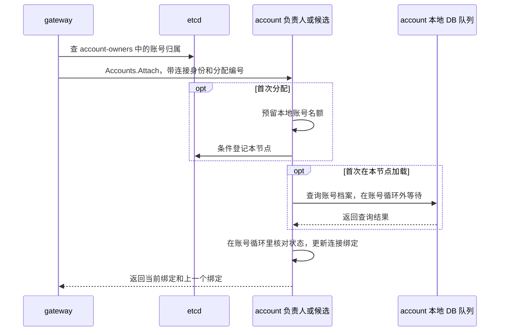

# 在线账号管理

认证可以由任一 account 节点处理。凭据验证完成后，gateway 找到账号的负责人，并通过定向 RPC 更新连接。负责人在内存中保存账号资料，每个在线账号有自己的循环。返回选角会释放 game 的玩家对象，保留 account 里的在线账号。

## 首次关联和顶号

竞争首次分配时，只有取得归属的节点加载账号。候选回复已有其他负责人时，网关最多向该负责人转交一次关联请求。归属或 RPC 结果未知时返回错误。同账号顶号保留已加载的资料。game 的归属另存在 `accounts`，与 `account-owners` 分开。[网关关联入口](../servers/gateway/internal/connection/account.go) · [账号管理器](../servers/account/internal/account/account_manager.go)

## 修改、保存和释放

- 已授权的本服务入口用 `AccountManager.Call(ctx, accountID, bytes, fn)` 把操作交给在线账号循环；回调中可用 `Account.Data()` 读取副本、用 `SetStatus` 修改状态。该入口只处理本节点的在线账号，调用方负责认证和找到负责人。直接改数据库可能被内存里的数据覆盖。[账号对象](../servers/account/internal/account/online_account.go)
- 周期保存将变化的 `status` 作为独立值交给 DB 队列。队列接单后更新已提交值。数据库执行失败会记日志，任务不会自动重放。
- 当前绑定断线时，后台退出任务停止账号循环，提交剩余变化，即使没有新变化也等待最后一笔已提交的保存，最多 5 秒。循环发生 panic 时跳过最后一次采集，仍等已经提交的任务。替换前的连接发来的迟到通知不能关闭新绑定。
- 保存失败或等待超时会记日志，然后仍尝试条件删除原归属。删除通信失败时保留退出条目，每隔 3 秒重试原分配的删除，期间拒绝重新接入。确认删除或确认原归属已不匹配后移除本地条目。进程终止后后台任务随之结束，节点失联不会自动释放正式归属。[退出与释放实现](../servers/account/internal/account/release.go)
