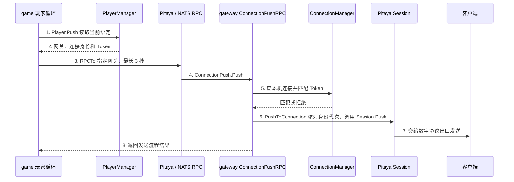

# 玩家响应与主动推送

## 回答请求

在玩家组件的方法里返回该接口的响应。网关和 game 处理内部 RPC 的编解码，框架为客户端响应写入消息编号，保留 Pitaya 的请求序号。使用经验道具成功后，背包按实际剩余数量和新的角色数值构建响应。[实际组件方法](../servers/game/internal/player/modules/inventory/action.go)

```go
return &pb.UseExpItemRep{
    ItemId:         request.ItemId,
    RemainingCount: inventoryModule.Count(request.ItemId),
    Experience:     inventoryModule.profile.Experience(),
    Level:          inventoryModule.profile.Level(),
}, nil
```

客户端用响应中的值更新相关字段。进入角色以及显式调用 `Player.Current` 才返回完整状态。业务失败通过 Pitaya 错误通道返回。[请求与响应](protocol-replies.md)

## 向当前玩家推送

在所属玩家循环内取得 `*player.Player` 后调用 `onlinePlayer.Push(ctx, notification)`。消息类型须在协议目录登记，调用方无需指定路由或拼接连接标识。外部管理入口需要先完成授权，再通过负责人进入玩家循环，不能长时间持有在线对象的指针。[game 发送入口](../servers/game/internal/player/push.go)



网关先核对 RPC 身份和目标节点，再检查本机绑定；这一步不等待普通请求转发使用的连接锁。替换后才开始的推送使用新绑定，正在传输的消息无法撤回。推送失败不自动重试、不改投其他连接。返回成功也不代表客户端已读；重连后可通过 Enter 或 Current 同步状态。[网关接收入口](../servers/gateway/internal/connection/connection_push_rpc.go)

| 发送目标 | 使用方式 |
| --- | --- |
| 本次请求的连接 | 返回具体的 Rep |
| 网关里当前请求的已登录连接 | `App.PushMessage(ctx, message)` |
| game 里该玩家的当前连接 | `Player.Push(ctx, message)` |
| 多个账号 | `App.PushToUsers(ctx, "gateway", uids, message)`，传 1–128 个不重复的 Pitaya 字符串 UID；接收范围由服务端校验。账号广播在跨网关换绑的窗口可能命中两个订阅。 |

定向推送也受 RPC 并发上限和截止时间约束。如在玩家循环中等待网关应答，该玩家后续任务需要等待；业务自行处理发送失败。
