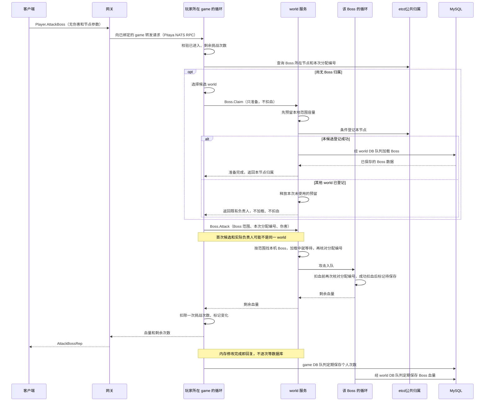

# 公共服务示例：玩家挑战世界 Boss

个人挑战次数由 game 的玩家循环修改，公共血量由 world 的 Boss 循环修改。客户端通过 gateway 调用 `Player.AttackBoss`，两份数据分别定期保存。

## 调用与保存

## 从客户端发起攻击

1. 按[入门说明](getting-started.md)配置 NATS、etcd、MySQL、账号开发凭据和 game 使用的配置表，生成协议与配置数据并构建。从四个终端分别启动 `account`、`game`、`world`、`gateway`。每个服务使用自己的 NATS 凭据。
2. Windows 用 `scripts\Start.bat world configs\world.json` 启动 world；Linux 用 `sh scripts/Start.sh world configs/world.json`。其他三个服务同样传对应的服务名和配置文件。
3. 在设好 `HT_DEV_TICKET` 的客户端终端运行 `go run ./cmd/client -zone default -boss`。客户端登录、查询逻辑区和角色列表、进入角色、更新偏好，然后攻击一次并离开。对初始血量 1000 的 Boss，拥有三次挑战机会的新角色首次攻击成功会看到血量 990、剩余次数 2。已有角色或 Boss 则按其当前状态计算。

## 分工与保存

- 每个逻辑区有一个 Boss，范围键为 `boss:` 加上区服名的 Base64URL 编码。攻击时 game 查询归属；尚无归属时先选候选 world，只发 `Boss.Claim`。候选先预留容量再登记，只有取得归属的节点加载数据。game 向实际负责人发送一次 `Boss.Attack`。[个人次数与 RPC](../servers/game/internal/player/modules/challenge/world_boss.go) · [world 的认领和加载](../servers/world/internal/boss/ownership.go)
- world 等该 Boss 就绪，在入队前及扣血前核对分配编号。客户端不能传伤害值。game 的示例规则固定伤害为 10，Boss 已死亡会拒绝攻击。成功回复后 game 扣一次个人机会，两边分别标记变化。[Boss 请求入口](../servers/world/internal/boss/boss_rpc.go)
- game 与 world 默认各自每 10 秒尝试保存。world 的默认上限为 128 个范围，每范围可排队 64 条任务，按估算值限制为 1 MiB。一个玩家断开连接不释放公共 Boss。增加 world 可以接纳新范围，同一个 Boss 仍由原循环顺序扣血。[world 配置](../configs/world.json)
- 正常停服时 world 先等所有 Boss 循环停止。停循环超时会返回错误，不读取仍可能变化的内存。停止成功后逐个 Boss 提交剩余变化、等最后一笔已提交的保存，并只对成功收尾的范围释放归属。异常或保存失败的范围记入错误，应在确认旧进程与旧写入已结束后人工处理。[停服实现](../servers/world/internal/boss/boss_service.go)

## RPC 超时意味着什么

world 可能已扣血，而 game 没收到回复，因此不会扣个人次数；两边写库也可能各自成功或失败。示例不会自动重发攻击或补偿。玩家循环等这次 RPC 期间，该玩家的后续任务会排队，公共服务不能同步回调正在等待它的同一玩家循环。该例没有每日重置、Boss 重生或奖励发放逻辑。
